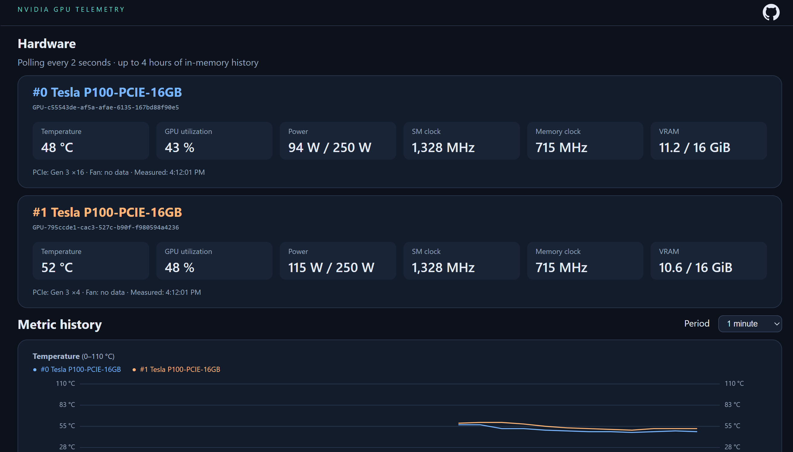

# nvidia-smi-to-web

A lightweight web application that exposes NVIDIA's `nvidia-smi` readings through a browser interface. Its purpose is to make GPU monitoring accessible without opening a shell—especially when GPUs run on a remote machine and you do not have shell access to it. Once the application is running on that machine and its web endpoint is reachable, you can check GPU metrics and recent history from your browser.

Built with Java 21 and the JDK's embedded HTTP server, it collects readings by running `nvidia-smi` locally on the GPU host. It works on Windows 11 and Ubuntu 26.x (x86-64).

- Live temperature, GPU utilization, power, SM/memory clocks and VRAM usage.
- History charts grouped by metric, with consistent colors and legends for each GPU.
- Up to 4 hours of in-memory history; selectable periods from 1 minute to 4 hours (default: 5 minutes).
- Asynchronous updates that preserve page scroll position.
- No database, Python, CUDA Toolkit or third-party Java runtime dependencies.

History is cleared when the application stops. Metrics unavailable on a GPU, such as fan speed on passive Tesla cards, appear as “no data”.



## Requirements

- Java 21 or newer, including the `jdk.httpserver` module. A standard JDK installation includes it.
- An NVIDIA driver compatible with your GPU and OS, with a working `nvidia-smi` command.

Check your environment:

```sh
java -version
nvidia-smi
```

## Run a prebuilt JAR

Download a prebuilt JAR from the [GitHub Releases page](https://github.com/exadmin/nvidia-smi-to-web/releases). Releases are built automatically when a new tag is pushed; until the first tag is published, build from source or use a JAR provided separately. Each release includes `nvidia-smi-to-web.jar` and its SHA-256 checksum in `SHA256SUMS`.

Download `nvidia-smi-to-web.jar`, open a terminal in its directory, and run the same command on Windows or Ubuntu:

```sh
java -jar nvidia-smi-to-web.jar
```

Open [http://127.0.0.1:8080](http://127.0.0.1:8080) in your browser. Keep the terminal running; press **Ctrl+C** to stop. If you download another version, substitute its JAR filename in the command.

To preview the dashboard without NVIDIA hardware:

```sh
java -jar nvidia-smi-to-web.jar --demo
```

Demo mode is clearly labeled and uses synthetic values.

## Build from source

Install a **JDK 21+** with `javac` and `jar`, then clone the repository:

```sh
git clone https://github.com/exadmin/nvidia-smi-to-web.git
cd nvidia-smi-to-web
```

Choose one build method.

### Maven

Requires Maven in addition to the JDK:

```sh
mvn package
```

### Windows PowerShell, without Maven

```powershell
.\build.ps1
```

### Ubuntu, without Maven

```sh
sh build.sh
```

All methods produce `target/nvidia-smi-to-web-1.0.0.jar`, with the web resources included. Run it with:

```sh
java -jar target/nvidia-smi-to-web-1.0.0.jar
```

The same JAR works on both operating systems with a compatible Java installation.

## Configuration

| Option | Default | Purpose |
| --- | --- | --- |
| `--host` | `127.0.0.1` | Address to listen on |
| `--port` | `8080` | HTTP port |
| `--nvidia-smi` | `nvidia-smi` | Executable name or full path |
| `--demo` | Off | Use synthetic GPU data |

Example on Ubuntu:

```sh
java -jar nvidia-smi-to-web.jar --port 9090 --nvidia-smi /usr/bin/nvidia-smi
```

On Windows, quote paths containing spaces:

```powershell
java -jar nvidia-smi-to-web.jar --nvidia-smi "C:\path with spaces\nvidia-smi.exe"
```

The executable is normally resolved through the Java process's PATH. If it cannot be found, pass its actual full path with `--nvidia-smi`.

To allow connections from other machines, add `--host 0.0.0.0` and open the chosen TCP port in your firewall. There is no built-in authentication; use a reverse proxy with TLS and authentication for internet access.

## Sampling and API

One collector polls all GPUs, waiting 2 seconds after each completed poll. The process timeout is 5 seconds, so actual sample spacing includes command execution time. Multiple browsers share the same collector. Failed polls mark readings stale without inserting duplicate history points.

Each GPU retains up to 7200 samples in primitive-array ring buffers. For two GPUs, the history arrays occupy about **1.32 MiB**, excluding JVM, HTTP and JSON overhead. Points older than 4 hours are excluded.

- `GET /api/gpus`: current readings and history. `metrics` defines the order of `values`; history rows are `[timestampMillis, ...values]`.
- `GET /api/gpus?since=timestampMillis`: history points strictly newer than the timestamp.
- `GET /api/health`: HTTP 200 for fresh successful readings, otherwise 503. Includes a `demo` flag.

## Tests

Java tests on Windows:

```powershell
.\test.ps1
```

Java tests on Ubuntu:

```sh
sh test.sh
```

Dashboard regression checks require Node.js and run from the repository root:

```sh
node src/test/js/dashboard.test.cjs
```

Tests cover parsing, unavailable sensors, ring-buffer retention, incremental history, process errors/timeouts, and stable dashboard elements during updates. Real hardware readings must be verified on the target machine without `--demo`.

## Publishing a release

1. Commit the release changes and push them to GitHub, including the release workflow:

```sh
git add .
git commit -m "Prepare release v1.0.0"
git push origin master
```

2. Create a new version tag and push it:

```sh
git tag v1.0.0
git push origin v1.0.0
```

Use a new, unique version for each release, for example `v1.0.1` for the next one. If all changes are already committed, skip the `git add` and `git commit` commands.

3. Follow the **Build and publish release** workflow on the [Actions page](https://github.com/exadmin/nvidia-smi-to-web/actions/workflows/release.yml).
4. Once it succeeds, open [Releases](https://github.com/exadmin/nvidia-smi-to-web/releases) and download `nvidia-smi-to-web.jar`. The `SHA256SUMS` asset contains its checksum.

The release workflow runs Java and dashboard tests on Java 21, smoke-tests the packaged application in demo mode, and publishes a GitHub Release with the JAR and checksum only after all checks pass. It uses the built-in `GITHUB_TOKEN`; no additional secret is required. Any new tag triggers the workflow; moving an existing tag does not. Rerunning a successful release job replaces assets on that tag's existing release.
